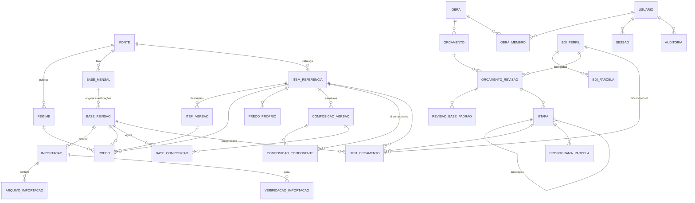

# Planejamento — Sistema de Orçamento de Obras (EMOP-RJ e SINAPI)

Versão 1 — 15/10/2026

Este documento responde aos 7 itens pedidos antes da programação. Os layouts
dos arquivos oficiais descritos aqui foram **lidos dos arquivos reais**
enviados (SINAPI 09/2026 e EMOP 09/2026), não presumidos. Detalhes técnicos
dos layouts estão em [`LAYOUTS.md`](LAYOUTS.md).

---

## 1. Arquitetura recomendada

```
 Navegador (usuário)
 ├─ Telas Next.js (React + Tailwind)
 └─ Web Worker de importação ── lê ZIP/RAR/XLSX/DBF em fluxo, calcula SHA-256,
        │                       normaliza com o MESMO adaptador do servidor
        │ lotes de ~2.000 linhas (JSON < 2 MB)
        ▼
 Servidor Next.js (funções serverless, Node.js)
 ├─ Server Actions / rotas /api  ── validação (zod), permissões, auditoria
 ├─ Núcleo de cálculo (decimal.js)  ── BDI, composições, arredondamento, ABC
 ├─ Adaptadores de importação  ── um por fonte+layout, versionados
 ├─ Relatórios  ── XLSX (exceljs) e PDF (pdfmake), gerados sob demanda
 └─ Prisma (CRUD)  +  SQL direto (staging, cargas em lote)
        │  conexão TLS, credenciais só no servidor
        ▼
 PostgreSQL no Neon
 ├─ schema public   ── dados definitivos (normalizados, NUMERIC, UUID)
 ├─ schema staging  ── tabelas UNLOGGED de pré-importação
 └─ gatilhos de integridade (bases publicadas e orçamentos fechados imutáveis)
```

Decisões e justificativas:

| Tema | Escolha | Por quê |
|---|---|---|
| Framework | Next.js 15 (App Router) + TypeScript | Front e back no mesmo projeto; hospedagem gratuita fácil |
| ORM | **Prisma 6** para o *esquema e migrações*; em execução, **SQL parametrizado** por um executor fino (`src/lib/banco/executor.ts`) | Na Cloudflare, conexões persistentes do Prisma não podem ser compartilhadas entre requisições (erro medido em produção). O executor usa o endpoint HTTPS do Neon, sem estado, e transações em lote — o mesmo caminho da importação. Localmente/testes usa node-postgres |
| Decimais | `decimal.js` (40 dígitos) + `NUMERIC` no banco | Nenhum valor monetário passa por `float` |
| Leitura DBF | **Leitor próprio** (`src/lib/importacao/leitores/dbf.ts`) | As bibliotecas testadas rejeitaram o DBF da EMOP (campos numéricos > 20 posições) e convertem números para `float`. O leitor próprio é em fluxo e devolve números como texto exato |
| Leitura XLSX | Leitor em fluxo (exceljs streaming) | O arquivo SINAPI tem 13,6 MB e ~67 mil linhas na aba Analítico |
| ZIP / RAR | `fflate`/leitor ZIP em fluxo e `node-unrar-js` (WebAssembly) | SINAPI vem em ZIP; EMOP vem em **RAR** |
| Autenticação | Própria: sessões no banco, cookie `httpOnly`, bcrypt | Simples, auditável, revogável, sem serviço externo |
| Relatórios | `exceljs` (XLSX) e `pdfmake` (PDF) | Rodam em funções serverless sem navegador embutido |

## 2. Modelo do banco PostgreSQL

O modelo completo está em [`prisma/schema.prisma`](../prisma/schema.prisma)
(comentado) e nas migrações em `prisma/migrations/`. Resumo por grupo:

**Usuários e segurança**: `usuario` (papel ADMIN/ORCAMENTISTA/LEITOR,
bloqueio após 5 falhas), `sessao` (hash SHA-256 do token), `obra_membro`
(permissão por obra), `auditoria` (somente inserção — garantido por gatilho).

**Referências**:
- `fonte` (SINAPI, EMOP, PROPRIA) e `regime` (regimes efetivamente publicados).
- `base_mensal` (fonte + UF + competência, única) → `base_revisao`
  (0 = original, 1, 2… = retificações; status EM_IMPORTACAO → VALIDADA →
  PUBLICADA → SUBSTITUIDA). No máximo uma revisão publicada por base.
- `importacao`, `arquivo_importacao` (SHA-256, tamanho, layout),
  `verificacao_importacao` (erros/avisos por linha).
- `item_referencia` (fonte + tipo + **código TEXT**), `item_versao`
  (descrição/unidade; nova versão só quando muda — economiza espaço),
  `preco` (revisão + item + regime → `NUMERIC(18,4)`; **ausência de linha =
  sem preço, nunca zero**), `preco_proprio` (cotações datadas).
- `composicao_versao` (estrutura deduplicada por hash; origem OFICIAL ou
  PROPRIA), `composicao_componente` (coeficiente `NUMERIC(24,10)`, campos
  originais preservados), `base_composicao` (qual versão vale em cada
  revisão/regime).

**Orçamentos**: `obra` → `orcamento` → `orcamento_revisao` (status,
`versao` para controle de concorrência, BDI global, arredondamento) →
`revisao_base_padrao` (base/regime padrão por fonte) → `etapa` (árvore de
etapas/subetapas) → `item_orcamento` (snapshot de código, descrição, unidade,
custo, BDI aplicado, preço; base e regime podem ser diferentes por item) e
`cronograma_parcela`. BDI: `bdi_perfil` → `bdi_parcela` (AC, S, R, G, DF, L, I).

**Regras garantidas pelo próprio banco** (testadas):
- Revisão de orçamento FECHADA não aceita INSERT/UPDATE/DELETE em itens,
  etapas, cronograma nem nela própria.
- Preços e composições de base PUBLICADA/SUBSTITUÍDA são imutáveis
  (correção = nova retificação).
- Componentes de composição são imutáveis; composição não contém a si mesma.
- Competência sempre no dia 1; valores e quantidades não negativos.
- Índices: código (B-tree e trigram), descrição sem acento (trigram),
  competência, fonte, regime.

## 3. Diagrama entidade-relacionamento



## 4. Estratégia de importação dos arquivos reais

### 4.1 O que os arquivos oficiais contêm (verificado)

**SINAPI** — ZIP `SINAPI-AAAA-MM-formato-xlsx.zip` com 4 planilhas. A principal,
`SINAPI_Referência_AAAA_MM.xlsx`, tem as abas:

| Aba | Conteúdo | Regime |
|---|---|---|
| ISD / ICD / ISE | Preços de insumos, uma coluna por UF (RJ = coluna "RJ") | Sem desoneração / Com desoneração / Sem encargos sociais |
| CSD / CCD / CSE | Custos de composições por UF (pares Custo + %AS) | idem |
| Analítico | Composição → componentes (INSUMO/COMPOSICAO), coeficiente, situação | independe do regime |

Portanto o SINAPI publica **3 regimes**. Armadilha encontrada: nas abas
CSD/CCD/CSE o código da composição está dentro de uma fórmula
`HYPERLINK(...MATCH(104658, ...))` e o valor gravado na célula é **0**; o
adaptador extrai o código da fórmula e confere com a aba Analítico.

**EMOP-RJ** — RAR mensal com DBFs (codificação CP850) e PDFs. Os `.xls` têm
conteúdo idêntico aos `.dbf` (byte a byte).

| Arquivo | Registros (09/2026) | Conteúdo |
|---|---|---|
| `DIPR` | 22.248 | Serviços: código, descrição (6 × 60 car.), unidade, custo |
| `EMOP` | 22.248 | Código e preço do serviço (= custo do DIPR) |
| `COMP` | 103.866 | Composição analítica: serviço, sequência, elementar, quantidade, percentual |
| `MAT`  | 5.268 | Insumos: código (5 dígitos, zeros à esquerda), descrição (4 × 40 car.), unidade, preço |
| `REUT` | 1.952 | Composições reutilizadas como elementares (elementar ↔ composição) |
| `ELEM` | 7.220 | Preço de todos os elementares (= MAT + REUT) |

Regime EMOP: definido **pelo último caractere do código**, conforme o
Catálogo de Referência oficial (13ª ed., item 2): dígitos 0–4 = sem
desoneração; letras A–E = com desoneração (0/A normal, 1/B reutilizada,
2–4/C–E categoria 19). O código completo (ex.: `01.001.0001-A`) é preservado.

Conferência feita com os dados reais: custo publicado =
truncar₂(Σ quantidade × preço do elementar × (1 + percentual/100)) confere
**exatamente em 22.013 de 22.238 serviços (99,0%)**; os demais diferem em
R$ 0,01. Por isso o sistema **sempre usa o custo publicado** como valor
oficial e usa o recálculo apenas como verificação (aviso, não erro).

### 4.2 Fluxo do assistente (10 passos)

1. **Fonte** — SINAPI ou EMOP.
2. **Competência** — lida do próprio arquivo (SINAPI: "Mês de Referência";
   EMOP: nome `0926` + boletim) e confirmada pelo usuário; divergência = erro.
3. **Regime** — SINAPI: os 3 regimes vêm no mesmo arquivo; EMOP: pelo
   sufixo do código. O usuário confirma quais importar.
4. **Upload** — o navegador lê o arquivo localmente (não há limite de 4,5 MB
   de upload) e calcula o SHA-256.
5. **Identificação do layout** — cada adaptador declara uma "assinatura"
   (nomes de abas e cabeçalhos; nomes e tipos de campos DBF). Se nenhum
   adaptador reconhece o arquivo, a importação para com mensagem clara —
   nunca tenta adivinhar.
6. **Validação** — códigos vazios/duplicados, preço ausente (aviso),
   preço zerado (aviso), negativo (erro), componente inexistente (erro),
   unidade ausente (erro), referência circular, totais de controle
   (quantidade de registros do cabeçalho DBF × lidos), recálculo EMOP.
7. **Pré-visualização** — contagens, novidades e removidos em relação ao
   mês anterior, amostra das linhas e lista de inconsistências.
8. **Confirmação** — exige ciência dos avisos. SHA-256 já importado =
   bloqueado, salvo autorização explícita de administrador (registrada).
9. **Gravação transacional** — dados enviados em lotes para `staging`; a
   confirmação executa `INSERT ... SELECT` numa **única transação**: ou tudo
   é gravado ou nada (testado com falha simulada).
10. **Relatório de inconsistências** — exportável em XLSX; fica guardado
    na importação.

Depois: **Validação** (conferência humana, amostral) → **Publicação**. Só
bases publicadas aparecem para novos orçamentos. Retificação = nova
`base_revisao` do mesmo mês; a anterior fica SUBSTITUÍDA, intacta para os
orçamentos que a usaram.

Adaptadores ficam em `src/lib/importacao/adaptadores/<fonte>-<layout>/`
com versão própria (gravada em cada importação). Mudou o layout oficial →
cria-se um novo adaptador; os antigos continuam reimportando meses antigos.

Também haverá um **importador por linha de comando** (mesmos adaptadores)
para a carga inicial de jan–set/2026 a partir de um computador.

## 5. Estratégia para permanecer no plano gratuito

*Atualizado em 16/10/2026 com medições reais (importação de 09/2026).*

| Serviço | Plano | Observações |
|---|---|---|
| Banco | **Neon Free** (0,5 GB) | O banco "dorme" quando ocioso (1ª requisição após pausa leva ~1 s) |
| Aplicação | **Cloudflare Workers** | Escolha do usuário. O plano gratuito limita a **10 ms de CPU por requisição** — insuficiente para login seguro e páginas; recomendado **Workers Paid (US$ 5/mês)**. Detalhes em [`IMPLANTACAO.md`](IMPLANTACAO.md) |
| Código | GitHub (privado) | GitHub Actions roda os testes a cada envio |
| Backups | GitHub Actions + Neon | `pg_dump` diário (Etapa 6) |

Espaço medido no Neon após importar SINAPI-RJ e EMOP de 09/2026: **~120 MB**,
dos quais ~90 MB são cadastro "único" (descrições e estruturas de composições,
reaproveitadas nos meses seguintes enquanto não mudarem). Cada nova competência
acrescenta estimados **~28 MB** (preços e vínculos). Previsão: **cabe ~12–13
meses** no plano gratuito. Depois: arquivar competências antigas não usadas
em orçamentos, ou plano pago do Neon.

Medidas já aplicadas: só a UF RJ é gravada; descrições e composições
deduplicadas por hash; staging `UNLOGGED` e compactado após cada importação;
arquivos originais não ficam no banco (só o SHA-256); leitura dos arquivos no
navegador; índice redundante removido.

## 6. Plano de testes

| Camada | Ferramenta | O que cobre |
|---|---|---|
| Unidade | Vitest | Decimal/arredondamento, BDI (TCU 2.622/2013), composições, ciclos, ABC, numeração, leitor DBF |
| Banco | Vitest + PostgreSQL de teste | Gatilhos de imutabilidade, unicidade, zeros à esquerda, precisão NUMERIC |
| Importação | Vitest + **amostras reais** | Recortes pequenos dos arquivos oficiais (fixtures) + arquivos corrompidos/truncados; conferência de totais com o arquivo completo |
| Ponta a ponta | Playwright | Login, permissões, assistente de importação, orçamento, exportações |

Casos obrigatórios (do pedido) e situação:

| Caso | Situação |
|---|---|
| Precisão financeira e arredondamentos | ✅ feito |
| BDI individual por item | ✅ feito |
| Composições com múltiplos componentes / circulares | ✅ feito |
| Preços ausentes ou zerados | ✅ (cálculo) — importação na Etapa 2 |
| Códigos com zeros à esquerda | ✅ (banco) — importação na Etapa 2 |
| Competências duplicadas, bases retificadas | ✅ (banco) — fluxo na Etapa 2 |
| Preservação de revisões encerradas | ✅ feito (gatilhos) |
| Login seguro, sessão forjada | ✅ feito (E2E) |
| Importação válida/inválida, falha e rollback | ✅ feito |
| Diferentes regimes | ✅ feito (3 SINAPI, 2 EMOP) |
| Exportação PDF/XLSX | Etapa 5 |
| Confronto com registros oficiais | ✅ 140/140 valores no Neon iguais aos oficiais (PDFs EMOP e planilha SINAPI lida por ferramenta independente); recálculo EMOP 22.013/22.238 idênticos |

## 7. Cronograma por módulos

Cada etapa termina com testes passando e uma demonstração para sua validação.

| Etapa | Entregas | Situação |
|---|---|---|
| 1 — Fundação | Projeto, banco, migrações, gatilhos, login, permissões, auditoria, tela inicial, núcleo de cálculo | **Concluída** |
| 2 — Importação | Leitores ZIP/RAR/XLSX/DBF, adaptadores SINAPI-2025 e EMOP-DBF, assistente de 10 passos, publicação/retificação, importador CLI, carga 09/2026 no Neon | **Concluída** |
| 3 — Consulta | Busca por código/descrição, histórico de preços, composição analítica (só onde publicada), composições próprias, precificação multi-fonte | **Concluída** (aguarda validação) — no ar |
| 4 — Orçamentação | Obras, orçamentos, etapas, itens, quantitativos, BDI global/individual, revisões, duplicação, atualização de competência, fechamento, concorrência | |
| 5 — Relatórios | 10 relatórios em PDF e XLSX | |
| 6 — Produção | Neon + hospedagem, domínio, backups automáticos com teste de restauração, revisão de segurança | |
